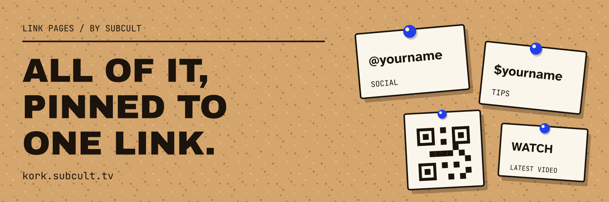

# Kork



**One link in your bio. Everything else pinned to it.**

Kork is a free link page by SUBCULT for your socials, music, videos, shop, tip
jars and contact details. Pick a theme, pin up what you want people to find and
share one address. Payment buttons go to your own accounts; Kork never touches
the money and takes no cut. It launched in October 2026 and is still early, so
expect rough edges.

Make a page at <https://kork.subcult.tv/>. The banner uses example handles and a
decorative QR glyph; it is not a real person's page or a scannable code.

## Features

- **92 services** with brand icons and handle checks: social profiles, music,
  video, shops, payments, crypto and contact accounts. Handles become the right
  URL for each service, and copy-only services such as Zelle or a wallet address
  become copy buttons with a QR code.
- **Blocks:** links, headings, text, images, dividers, QR codes, copy buttons, a
  vCard contact card, a location link, an email sign-up, an events list and a
  latest video or post.
- **Embeds** from YouTube, Vimeo, Spotify, SoundCloud, Twitch and Apple Music.
- **Ten theme presets**, then your own colors, font, button style and shape,
  background, and a stacked or numbered-ledger layout.
- **Events** with ticket links. Past dates hide themselves, and the block can be
  filled from a calendar (ICS) feed.
- **Latest video or post** from a YouTube channel or any RSS or Atom feed.
- **Email sign-up** with double opt-in. Addresses stay in Kork or go to your own
  Brevo or listmonk list.
- **Import** a page from Linktree and other link pages, or from a Kork export.
  Link previews fill in titles and images.
- **Analytics** per page: daily views, clicks, referrer domains and countries,
  with an optional weekly email. No visitor IPs, cookies or user agents are
  stored, and visitor pages load no trackers. Embeds you add follow their own
  policies.
- **Your account:** change email or password, download everything as a ZIP, or
  delete the account.
- **Safety:** email verification before publishing, a 24-hour wait before a new
  account can publish, rate limits, page reports with an admin queue, and
  optional link screening against Google Safe Browsing or a blocklist such as
  PhishTank. Screening cannot catch every bad link.

The software also has an optional Pro tier (custom domains, custom CSS, font
uploads, stats export, scheduled links and hiding the footer credit). It is off
unless a deployment configures Stripe or Patreon billing or grants Pro by hand.

## Quick start

You need Go 1.26 or newer, Node 22 or newer, and Docker for Postgres.

```bash
make web    # build the editor (again after editor changes)
make run    # start Postgres on :5433 and the server on :8080
```

Open <http://localhost:8080/app/signup>. Without SMTP, verification and
password-reset links are printed in the server log. Add your email to
`ZELDA_ADMIN_EMAILS` to make your account an admin.

For editor work, run `cd web && npm run dev` next to `make run`; Vite proxies
API calls to :8080.

To create a verified demo account with a published page, start the server with
the publish wait turned off and its log saved, then run the seed script:

```bash
ZELDA_PUBLISH_MIN_ACCOUNT_AGE=0 make run 2>&1 | tee server.log
scripts/seed-demo.sh http://localhost:8080 server.log
```

Tests and checks:

```bash
make test   # Go tests (including a Postgres end-to-end test), editor typecheck and Vitest
make lint   # go vet and gofmt
```

`make test-go` uses a separate `zelda_test` database because the end-to-end test
wipes its schema.

## Configuration

Copy `.env.example` to `.env`. The code still uses its original `zelda` name for
the module, binary and variables.

| Variable | Purpose |
| --- | --- |
| `ZELDA_BASE_URL`, `ZELDA_HOST` | Public origin and its hostname |
| `ZELDA_APP_NAME` | Site name (default `Kork`) |
| `POSTGRES_PASSWORD` | Database password for the Compose stack |
| `ZELDA_ADMIN_EMAILS` | Admin accounts, once their email is verified |
| `ZELDA_SMTP_HOST`, `ZELDA_SMTP_PORT`, `ZELDA_SMTP_USER`, `ZELDA_SMTP_PASSWORD`, `ZELDA_MAIL_FROM` | Email for verification, resets, sign-up confirmations and weekly stats |
| `ZELDA_SECRET_KEY` | 32-byte key that encrypts stored secrets such as creators' Brevo keys |
| `ZELDA_PUBLISH_MIN_ACCOUNT_AGE` | Wait before a new account can publish (default `24h`, `0` turns it off) |
| `ZELDA_STATS_RETENTION_DAYS` | Days of daily stats to keep |
| `ZELDA_FREE_PAGE_LIMIT` | Pages a free account can create (default 5) |
| `ZELDA_TRUST_PROXY`, `ZELDA_CLIENT_IP_HEADER`, `ZELDA_PROXY_HOPS` | Which forwarded address to trust behind a proxy |
| `ZELDA_CUSTOM_DOMAINS`, `ZELDA_DOMAIN_TARGET` | Custom domains through the bundled Caddy |
| `ZELDA_CLOUDFLARE_TOKEN`, `ZELDA_CLOUDFLARE_ZONE_ID` | Custom domains through Cloudflare for SaaS instead |
| `ZELDA_SAFE_BROWSING_KEY`, `ZELDA_BLOCKLIST_FILE`, `ZELDA_BLOCKLIST_URL` | Link screening; with none set, links are not screened |
| `ZELDA_STRIPE_*`, `ZELDA_PRICE_DISPLAY_*`, `ZELDA_PATREON_*` | Optional billing; see [docs/billing.md](docs/billing.md) |
| `ZELDA_CONTACT_EMAIL` | Contact address on `/terms` and `/privacy` |
| `ACME_EMAIL` | Let's Encrypt account email for the bundled Caddy |

## Deploy

The `Dockerfile` builds one static binary with the editor embedded, on a
distroless image. Uploaded images live in the `/data` volume; everything else is
in PostgreSQL. Migrations run when the server starts.

- `docker compose up -d --build` runs Postgres, the app and Caddy, which handles
  TLS and on-demand certificates for verified custom domains. Ports 80 and 443
  must reach Caddy.
- `docker-compose.proxy.yml` runs only Postgres and the app, published on
  `ZELDA_PUBLISH`, for hosts where another reverse proxy handles TLS. Set
  `ZELDA_TRUST_PROXY` and turn custom domains off unless that proxy can issue
  certificates for any hostname.

`scripts/backup.sh` writes a checked database dump and an uploads archive, keeps
the newest 14 and can copy them to another host. Keep a copy of
`ZELDA_SECRET_KEY` with your backups. [DEVELOPMENT.md](DEVELOPMENT.md) covers
custom domains, restore steps, terms and privacy pages, and the abuse controls
in more detail. The API between the editor and the server is described in
[docs/api.md](docs/api.md).

## Project layout

```text
cmd/zelda          entry point
internal/catalog   services, block types and themes
internal/blocks    block validation, embeds, vCard
internal/render    public page templates, static CSS and JS, legal pages
internal/server    HTTP handlers, auth, rate limits
internal/store     Postgres queries
internal/db        connection pool and embedded migrations
internal/billing   Stripe and Patreon clients
web/               React editor (Vite), served at /app
deploy/Caddyfile   TLS and on-demand certificates
```

Brand icons come from [Simple Icons](https://simpleicons.org) (CC0); regenerate
them with `make icons`.

## Contributing

- Bugs and feature requests: [GitHub issues](https://github.com/subculture-collective/kork/issues).
- Questions and ideas: [GitHub Discussions](https://github.com/subculture-collective/kork/discussions).
- Code: open a pull request on GitHub against `main`. CI checks Go formatting
  and `go vet`, scans Go modules with govulncheck and the editor with
  `npm audit`, runs the editor typecheck and tests, runs all Go tests with the
  race detector against PostgreSQL, and builds the server.

## License

Original contributions are licensed under the GNU General Public License,
version 3 or any later version (`GPL-3.0-or-later`). See [LICENSE](LICENSE).
Third-party code, fonts, data and other assets keep their own licenses and
notices.
