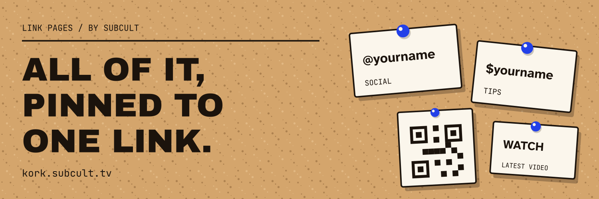

# Kork

**One link in your bio. Everything else pinned to it.**

Kork gives you a free page for your socials, music, videos, shop, tip jars and
contact details. Pick a theme, pin up what you want people to find, and share
your page. It's new; expect a few rough edges.

[Make your page](https://kork.subcult.tv/) · [Product overview](https://subcult.tv/products/kork) · [Report a rough edge](https://git.subcult.tv/subculture-collective/kork/issues)

## Room for more than links

- **92 services.** Social profiles, music, video, shops, payments, crypto and
  contact accounts, with brand icons and handle checks.
- **Ten themes.** Choose one, then change the colors, fonts, buttons, layout and
  background. Use stacked cards or a numbered ledger.
- **Media on the page.** Add images and YouTube, Vimeo, Spotify, SoundCloud,
  Twitch or Apple Music embeds.
- **Useful little things.** QR codes, copy buttons, a downloadable contact
  card, headings, text, dividers and a location link.
- **A page that changes with the week.** Schedule links, let them expire, add
  event dates or a latest video/post block.
- **Bring your old page.** Import from Linktree and other link pages; add
  automatic link previews.
- **Keep in touch.** An email sign-up block asks visitors to confirm before
  joining your list.

The banner uses example handles and a decorative QR glyph. It is brand artwork,
not a published person's page or a scannable code.

## Your tips go to you

Payment buttons go straight to your own Cash App, PayPal and similar accounts.
Kork doesn't process the money and takes no cut of tips or sales.

Page analytics show daily views, clicks, referrer domains and countries, with
an optional weekly email. Kork's analytics store no visitor IPs, cookies or
user agents and use no trackers. Third-party embeds you add have their own
behavior and policies.

## Before you publish

New accounts wait **24 hours** before publishing. Saved links are checked
against PhishTank's verified phishing URLs; this list cannot catch every threat.
Custom domains and paid plans are not available on the public service.
You can export your account as a ZIP or delete it.

Built by [SUBCULT](https://subcult.tv). For self-hosting, setup, tests and
deployment, use the [development guide](DEVELOPMENT.md). The implementation
keeps the historical `zelda` module and configuration identifiers.

## License

Original contributions in this repository are licensed under the GNU General
Public License, version 3 or (at your option) any later version
(`GPL-3.0-or-later`). See [LICENSE](LICENSE).

Third-party code, documentation, fonts, data, and other assets retain their own
licenses, copyright notices, and attribution. This license does not replace
those terms or grant rights to upstream material that its authors have not granted.
